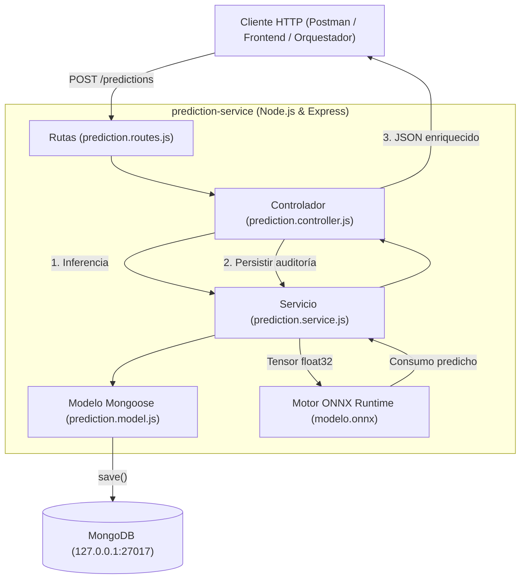

# Documentación Técnica: Persistencia de Datos con MongoDB

**Asignatura:** Sistemas Operativos y Distribuidos  
**Proyecto:** Microservicio de Predicción (`prediction-service`)  
**Tecnologías:** Node.js, Express, MongoDB Community Server 9.0.8, Mongoose, ONNX Runtime  

---

## 1. Visión General de la Persistencia

El microservicio `prediction-service` combina la ejecución de inferencia en tiempo real de una red neuronal (MLP) mediante **ONNX Runtime** con una capa de persistencia desacoplada sobre **MongoDB**.

Cada vez que un cliente solicita una predicción, el servicio no solo calcula el valor inferido y la latencia, sino que almacena un documento inmutable de auditoría en la base de datos `prediction-service`.



---

## 2. Configuración del Entorno MongoDB en Windows

En el entorno de desarrollo (Windows 11), MongoDB está instalado como servicio con **inicio manual** para optimizar el consumo de RAM:

* **Directorio binarios:** `C:\MongoDB\mongodb-win32-x86_64-windows-9.0.8\bin\mongod.exe`
* **Directorio de datos (dbPath):** `C:\data\db`
* **Archivo de configuración:** `C:\MongoDB\mongod.cfg`
* **Dirección de escucha:** `127.0.0.1:27017`
* **Nombre del servicio de Windows:** `MongoDB`

### Comandos de gestión del servicio (PowerShell como Administrador):

```powershell
# Iniciar la base de datos
Start-Service MongoDB

# Consultar estado (Running / Stopped)
Get-Service MongoDB

# Detener la base de datos al finalizar el trabajo
Stop-Service MongoDB
```

---

## 3. Esquema de Datos (`src/models/prediction.model.js`)

Se ha diseñado un esquema Mongoose estructurado que recoge tanto los datos de entrada como las métricas de inferencia:

```javascript
'use strict';

const mongoose = require("mongoose");
const Schema = mongoose.Schema;

const PredictionSchema = new Schema({
    // Identificador único universal de la predicción (UUID v4)
    predictionId: {
        type: String,
        required: true,
        unique: true
    },
    // Consumo eléctrico predicho por la red neuronal
    prediction: {
        type: Number,
        required: true
    },
    // Marca de tiempo ISO-8601 del momento exacto del cálculo
    timestamp: {
        type: String,
        required: true
    },
    // Tiempo de ejecución en milisegundos de la inferencia ONNX
    latencyMs: {
        type: Number,
        required: true
    },
    // Identificador opcional correlativo del dato original (ej. ID sensor)
    dataId: {
        type: String,
        default: null
    },
    // Vector con los 7 valores de entrada que alimentaron el modelo
    features: {
        type: [Number],
        required: true
    }
}, {
    versionKey: false // Evita el campo interno __v de Mongoose
});

module.exports = mongoose.model("Prediction", PredictionSchema);
```

### Justificación de los campos:
* `predictionId`: Permite correlacionar peticiones a través de múltiples microservicios distribuidos sin exponer los IDs internos del gestor de base de datos.
* `latencyMs`: Métrica crítica para Sistemas Distribuidos (SLA / QoS), permitiendo monitorizar sobrecargas o degradaciones del servicio.
* `features`: Registro inmutable de los datos de entrada para auditoría y reentrenamiento posterior (detección de *Data Drift*).

---

## 4. Arquitectura Modular por Capas

Siguiendo las pautas de `Material_complementario_CRUD.pdf`, la persistencia se integra de forma desacoplada:

### 4.1. Conexión Resiliente (`server.js`)
La conexión a MongoDB se inicializa de manera no bloqueante:

```javascript
const MONGO_URI = process.env.MONGO_URI || "mongodb://127.0.0.1:27017/prediction-service";

try {
    await mongoose.connect(MONGO_URI);
    console.log("Conexión a la base de datos establecida");
} catch (err) {
    console.error("Error de conexión a la base de datos:", err);
}
```

> **Resiliencia:** Si MongoDB no está iniciado cuando se arranca el microservicio, este no se cae inmediatamente en un crash fatal; reporta el error y la sonda de preparación (`/ready`) devolverá `503 Service Unavailable` hasta que la base de datos se levante.

### 4.2. Capa de Servicios (`src/services/prediction.service.js`)
Aísla el acceso a MongoDB encapsulando las operaciones CRUD:

* **Guardar:** `savePrediction(data)` $\rightarrow$ `new Prediction(data).save()`
* **Listar:** `getPredictions()` $\rightarrow$ `Prediction.find()`
* **Buscar por ID:** `getPredictionById(id)` $\rightarrow$ Búsqueda polimórfica: comprueba si el `id` es un `ObjectId` nativo de MongoDB (`findById`) o un UUID `predictionId` (`findOne({ predictionId })`).
* **Eliminar:** `deletePredictionById(id)` $\rightarrow$ `findByIdAndDelete` / `findOneAndDelete`.
* **Sonda de Readiness:** `isReady()` $\rightarrow$ Verifica conjuntamente `session != null` (modelo ONNX cargado) y `mongoose.connection.readyState === 1` (MongoDB conectado).

### 4.3. Capa de Controladores (`src/controllers/prediction.controller.js`)
Coordina el flujo de datos HTTP:
* Ejecuta la inferencia ONNX y mide la latencia (`Date.now() - start`).
* Invoca a `predictionService.savePrediction(...)` protegiendo la respuesta al cliente.
* Maneja códigos de estado HTTP estándar: `200 OK`, `400 Bad Request`, `404 Not Found`, `500 Internal Server Error`, `503 Service Unavailable`.

### 4.4. Capa de Rutas (`src/routes/prediction.routes.js`)
Publica los endpoints REST:
```javascript
router.get("/features", controller.getFeatures);
router.post("/predictions", controller.predict);
router.get("/predictions", controller.getPredictions);
router.get("/predictions/:id", controller.getPredictionById);
router.delete("/predictions/:id", controller.deletePrediction);
router.get("/health", controller.health);
router.get("/ready", controller.ready);
```

---

## 5. Catálogo de Endpoints REST

| Método | Endpoint | Descripción | Cuerpo de Petición (JSON) | Código y Respuesta Exitosa |
| :---: | :--- | :--- | :--- | :--- |
| **POST** | `/predictions` | Genera una predicción y la guarda en MongoDB | `{"features": [10.2, 9.8, 11.1, 14, 2, 6, 15], "dataId": "sensor-01"}` | `200 OK`<br>`{"predictionId": "...", "prediction": 12.45, "timestamp": "...", "latencyMs": 4, "dataId": "sensor-01"}` |
| **GET** | `/predictions` | Recupera el histórico de predicciones | *Ninguno* | `200 OK`<br>`{"predictions": [ {...}, {...} ]}` |
| **GET** | `/predictions/:id` | Consulta una predicción por `_id` o `predictionId` | *Ninguno* | `200 OK`<br>`{"prediction": {...}}` |
| **DELETE**| `/predictions/:id` | Elimina una predicción del histórico | *Ninguno* | `200 OK`<br>`{"mensaje": "Predicción eliminada correctamente"}` |
| **GET** | `/health` | Sonda de Liveness (proceso Node vivo) | *Ninguno* | `200 OK`<br>`{"status": "ok", "uptime": 120.4}` |
| **GET** | `/ready` | Sonda de Readiness (ONNX cargado + Mongo conectado) | *Ninguno* | `200 OK`<br>`{"ready": true}` *(o 503 si falta alguno)* |
| **GET** | `/features` | Consulta las 7 variables esperadas | *Ninguno* | `200 OK`<br>`{"features": [...]}` |

---

## 6. Inspección Visual con MongoDB Compass

1. Abrir **MongoDB Compass**.
2. Conectar a la cadena: `mongodb://127.0.0.1:27017`.
3. Navegar a la base de datos `prediction-service`.
4. Abrir la colección `predictions`.
5. Se pueden observar los documentos con su estructura completa, realizar filtros por fecha o por `predictionId` y exportar a formatos JSON/CSV.
